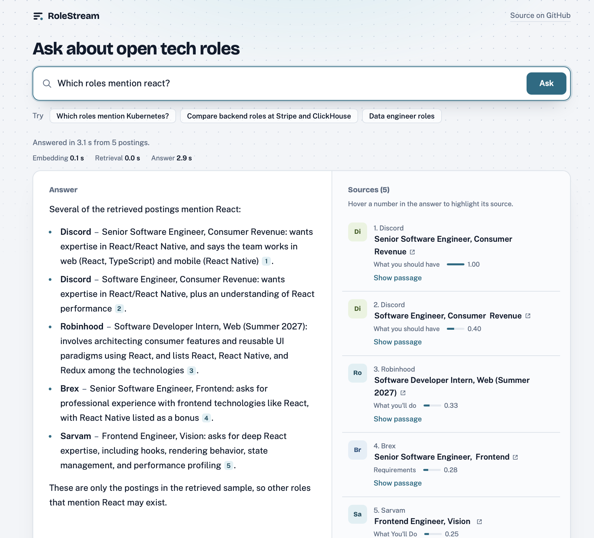
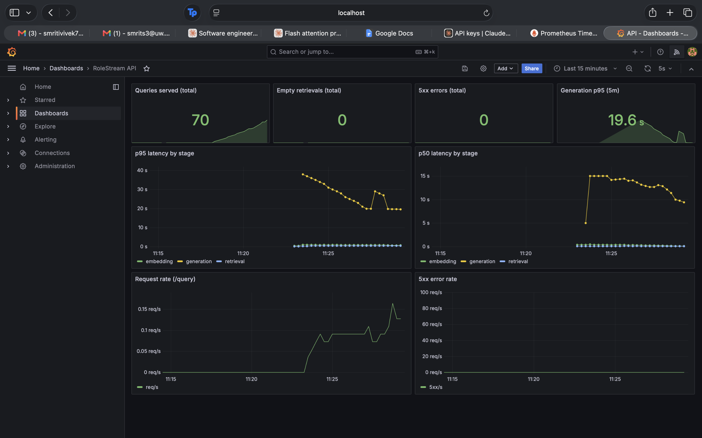

# RoleStream

RoleStream is a search and Q&A system over live job postings. It pulls openings from the public Greenhouse, Lever and Ashby APIs, streams every change through Kafka, and lets you ask questions like "which companies are hiring data engineers?" and get an answer with citations back to the actual postings.

I built it solo, mostly to learn how a streaming pipeline and a RAG system fit together, and to find out how bad retrieval gets when the data is messy real-world job text. The answer turned out to be "bad in specific, fixable ways", which is most of what the rest of this README is about.



## How it works

```
Greenhouse / Lever / Ashby APIs
        |
     pollers  -->  Postgres
                      |
                  Debezium (CDC)
                      |
              Kafka: rolestream.public.postings
                      |
              Go consumer (chunking)
                      |
              embedding service  -->  Qdrant (50,986 chunks)
                                          |
                  FastAPI /query and /query/stream (hybrid retrieval)
                                          |
                    Ollama (llama3.2:3b) or Claude
```

- **Pollers** (Python) hit the three job board APIs and write postings to Postgres.
- **Debezium** watches Postgres and publishes row changes to Kafka, so nothing downstream has to poll the database.
- **The Go consumer** reads the topic, splits each posting into chunks, and sends them to the embedding service.
- **The embedding service** produces a dense vector (`all-MiniLM-L6-v2`) and a sparse BM25 vector (fastembed) for each chunk. Both go into Qdrant.
- **The API** embeds the question, runs a hybrid search in Qdrant (dense and sparse results merged with reciprocal rank fusion), and hands the top chunks to a local `llama3.2:3b` model through Ollama, or to Claude if `GENERATOR=claude` is set. The model is told to answer only from those chunks and cite them.

Everything runs locally unless you switch the generator to Claude. Postgres, Kafka, Debezium and Qdrant are in `docker-compose.yml`. The embedding service, Ollama and the API run directly on the machine.

## Running it

Start the containers:

```bash
docker compose up -d
```

Then three terminals:

```bash
# embedding service
cd embedding && uvicorn service:app --port 8001

# local model
ollama serve

# API
cd api && uvicorn main:app --port 8000
```

Ask a question:

```bash
curl -s -X POST localhost:8000/query \
  -H "Content-Type: application/json" \
  -d '{"question": "Which roles mention Kubernetes?"}'
```

You can also open `localhost:8000` in a browser. The sources appear as soon as retrieval finishes, then the answer streams in as it is written, with each citation linked to the passage it came from and the time spent in each stage shown above the result. The page uses `POST /query/stream`, which sends newline-delimited JSON events: the sources first, then the answer text in pieces, then a final event with the timings. `POST /query` returns the same thing as one response.

The first request after starting Ollama is slow because the model has to load. After that it takes roughly 10 to 20 seconds per question with the local model.

To use Claude as the generator instead, set your key in the environment (keep it out of the repo) and start the API with:

```bash
export ANTHROPIC_API_KEY=...   # read from a file outside the repo, never committed
cd api && GENERATOR=claude uvicorn main:app --port 8000
```

That takes about 4 seconds per question. `CLAUDE_MODEL` picks the model (default `claude-sonnet-5-5`), `CLAUDE_MAX_CALLS` caps API calls per server run (default 300), and `CLAUDE_FALLBACK=1` falls back to Ollama if a Claude call fails. Fallback is off by default so a benchmark can't silently mix the two generators.

## Evaluating it

I wrote 55 questions (`docs/run_golden_questions.py`) covering language and tool lookups, company-specific questions, comparisons between two companies, salary questions, and a group of questions that should be refused: a "Chief Vibes Officer" role, COBOL developers, a "Time Travel Consultant", and so on. `docs/run_ragas_eval.py` runs them through the API and scores the answers with RAGAS v0.4.3, using Claude Haiku as the judge. It's reference-free, so there are no hand-written gold answers, only the question, the retrieved chunks and the response.

| Version | Faithfulness | Answer relevancy |
|---|---|---|
| First baseline | 0.76 | 0.60 |
| After adding the "no dates in the data" rule | 0.789 | 0.578 |
| Cross-company retrieval + query rewriter | **0.805** | **0.668** |
| Same run, answerable questions only (n=42) | 0.781 | 0.773 |
| Prompt fix: removed an example the model was copying | 0.789 | 0.681 |
| Same run, answerable questions only (n=42) | 0.785 | 0.733 |

All rows after the first are n=55 with nothing dropped. Judge noise on a run like this is around 0.03, so the faithfulness gain from the last change is within noise. The relevancy gain (+0.09) is not.

The latest run, after the prompt fix, is flat within noise: faithfulness 0.789 against 0.805 and relevancy 0.681 against 0.668. That change targeted one specific failure, a company name the model copied from an example in my own prompt, and an average over 55 questions barely registers a fix like that. I checked it by testing instead. Generation on this run took a median of 11.3 s and 18.5 s at p95 (max 27.6 s) per question on the local 3B model.

13 of the 55 questions are ones where the right answer is a refusal: 7 ask about roles that don't exist (COBOL, Fortran, a "Time Travel Consultant") and 6 ask about posting dates the data doesn't have. Those answers score well on faithfulness (roughly 0.88) but badly on relevancy (roughly 0.33), because the judge doesn't reward "that isn't in the data" as an on-topic answer. That's why the answerable-only rows exist: on the 42 answerable questions the latest run scores 0.733 relevancy and 0.785 faithfulness. The `docs/split_scores.py` script reproduces both views.

I read all 13 refusal answers by hand on the latest run. 12 are correct. The other one, for "Which companies have posted the most new roles this month?", claimed Anthropic had posted a new role this month based on a location string in a chunk, instead of saying dates aren't available. The script's phrase-based refusal check counts that answer as a refusal, so its 13 of 13 is an upper bound.

### Local model vs Claude

The generator is switchable (`GENERATOR=ollama|claude`, local by default). Retrieval is identical for both, so any difference comes from the model that writes the answer. I ran the same 55 questions through each and scored them the same way (n=55, nothing dropped for either).

| Generator | Faithfulness | Answer relevancy | Generation p50 / p95 |
|---|---|---|---|
| llama3.2:3b (local) | 0.789 | 0.681 | 11.3 s / 18.5 s |
| Claude Sonnet 5.5 | 0.864 | 0.257 | 3.7 s / 5.0 s |

On the 42 answerable questions the scores are 0.785 faithfulness and 0.733 relevancy for the local model, and 0.870 and 0.337 for Claude.

Claude is more faithful (+0.075, more than the roughly 0.03 judge noise) and about three times faster. Relevancy fell from 0.681 to 0.257, but I don't read that as worse answers. 37 of Claude's 55 answers scored exactly 0 on relevancy, against 10 of the local model's, and its answers are much longer (median 685 characters against 154). The lowest-scoring ones are careful: it says the postings show responsibilities and not a formal requirements list, or that a $190,000 to $230,000 range straddles $200k so it can't confirm. My system prompt tells the model to say it can only confirm what is in the retrieved sample. The 3B model mostly ignores that rule and Claude follows it closely. The relevancy metric appears to score hedged answers as 0, which fits the pattern, though I haven't confirmed that inside RAGAS. On this prompt, relevancy is not a fair comparison between the two models.

I read the opening of all 13 refusal answers from Claude by hand: 13 of 13 are correct, including the date question the local model got wrong.

Two caveats. The judge is Claude Haiku and the generator is Claude Sonnet 5.5, so faithfulness may be inflated by self-preference even though they are different models. And each number comes from one run. The next experiment is to soften the prompt so Claude only adds the "I only see a sample" caveat on questions about whether something exists.

**Retrieval check.** RAGAS depends on a judge model, so I also measure retrieval directly. For 12 questions I defined the true postings with a SQL query against Postgres (a keyword in the description, or a phrase in the title) and checked how many of the 5 retrieved postings are in that set. Mean precision@5 is 0.88, against roughly 0.04 for picking postings at random from the 6,610 open ones, and 11 of the 12 questions returned at least one correct posting. Retrieval is deterministic, so this reproduces exactly (`docs/eval_retrieval.py`). The weak spots are "data engineer" (3 of 5, and the label only counts exact title matches, so related roles like Analytics Engineer count as misses) and "Go" (0 of 5, the one question with no correct posting in the top 5, for the reasons in the limitations section). The labels are keyword matches, so a posting that mentions Kubernetes only in a nice-to-have list still counts.

I also track context precision, but I don't trust it with this judge and I'm not reporting it.

### What changed the numbers

**A prompt rule about dates.** The chunks have no posting dates, but the model kept answering "what was posted this week?" anyway. Telling it explicitly that dates aren't in the data and to say so took faithfulness from 0.653 to 0.789 on that run.

**Citing company and title, not just numbers.** Early answers were things like "[1], [3] and [5]", which is useless to read and hard to verify. The prompt now requires the company and job title next to each citation.

**Removing duplicate chunks.** The same role is often posted several times. I dedupe by posting ID and again by exact chunk text, otherwise one posting can fill the whole context window.

**Per-company retrieval for comparisons.** "Compare backend roles at Stripe and ClickHouse" used to return chunks from whichever company matched the query better. The API now pulls the company names out of the question and runs a separate filtered search for each one, so both show up.

**A query rewriter.** Hybrid search works better on "data engineer" than on "Which companies are hiring for data engineer roles?". The rewriter strips question words and generic filler like "roles", "hiring" and "postings" before embedding. It's a plain word list, not an LLM call, so it's fast and can't invent terms. If only one very short word is left, it falls back to the original question.

### What didn't work

I tried a prompt that told the model to restate the question, put one role per line, and only list a role if its chunk explicitly mentioned the topic. On paper it should have helped relevancy. Instead faithfulness dropped to about 0.76 and relevancy to about 0.64, and answers got long enough that more questions timed out during the golden run (8 failures on the first pass, versus 2 before). I reverted it. Two other runs of that experiment were thrown out because the judge hit timeouts and an empty credit balance and dropped rows, so the comparison above rests on one run with 1 to 3 dropped rows per metric. The gap was bigger than the dropped rows could explain, but it's not as clean as I'd like.

## Monitoring and load

The API exposes Prometheus metrics at `/metrics`: request counts and status codes, plus a histogram of time spent in each stage (embedding, retrieval, generation) and a counter for queries where nothing cleared the score threshold. Prometheus and Grafana run from a separate compose file, and the dashboard is provisioned from `monitoring/grafana/dashboards/rolestream.json`, so it loads automatically:

```bash
docker compose -f docker-compose.yml -f docker-compose.monitoring.yml up -d prometheus grafana
```

Grafana is at `localhost:3000` (admin / admin) and Prometheus at `localhost:9090`.



`docs/load_test.py` sends 30 questions one at a time after a warm-up request, so model loading doesn't count. On my M1 MacBook I ran it twice against the local model: all 60 requests succeeded, with p50 9.2 s both times, p95 17.3 s and 17.5 s, and a max of 27.8 s and 21.1 s. Nearly all of that is generation with the 3B model; retrieval stays well under a second. I only tested one request at a time because Ollama runs one generation at a time here, so concurrent requests would mostly queue. The web page streams the answer, which shows the first words sooner but doesn't shorten the total time. Going faster means a smaller or quantized model or a GPU box, not tuning the pipeline around it.

### Consumer lag

The same dashboard shows how far the Go consumer is behind Kafka, using a `kafka-exporter` container that reads the consumer group's lag from the broker. In steady state the lag sits at 0. After a Greenhouse poll that produced about 2,900 change events, the consumer took under 15 minutes to drain the backlog, so ingest runs at roughly 3 events per second or better on my laptop. Each event goes through chunking and the CPU embedding service, so that is the bottleneck of the pipeline, not Kafka. I checked that ingesting those events didn't create duplicate chunks: the collection went from 44,577 chunks over 5,831 open postings to 50,986 over 6,610, which is about 7.7 chunks per posting both times.

## Design decisions and tradeoffs

- **Debezium change capture instead of writing to Kafka from the pollers.** Postgres stays the single source of truth, and every insert, update and delete reaches Kafka from the database's write-ahead log, so a poller can't update the database and forget the index. The cost is more moving parts: logical replication and a connector to run.
- **One Kafka partition.** The topic only has partition 0. That keeps event order simple and is plenty for about 3 events per second of ingest. The tradeoff is that I can't run several consumers in parallel without adding partitions.
- **Section-aware chunking in Go.** Postings are split at their headings and long sections are windowed with overlap, so a chunk is about one topic and fits the embedding model's input limit (it truncates around 256 tokens). The tradeoff is that converting HTML to text runs bullet items together, which hurts some chunks.
- **Hybrid search merged with reciprocal rank fusion.** The dense vectors find meaning ("server-side developer" for "backend engineer") and BM25 finds exact terms ("Kubernetes"). Fusion uses each result's rank, so there are no scores to normalize. The tradeoff is that nothing reads the question and a chunk together, which is what a cross-encoder reranker would add.
- **A rule-based query rewriter, not an LLM.** It's deterministic, free, and can't invent search terms. The tradeoff is a word list I have to maintain, and short ambiguous words like "Go" still break retrieval.
- **A separate search per company, plus a per-company cap.** Comparison questions got results from only one side, and one company could fill the context. The cost is a few extra searches per comparison.
- **Local model by default, Claude as an option.** The local 3B model is free, private and works offline, but slow (a median of 11.3 s) and sometimes sloppy. Claude is about three times faster and more faithful, but costs money per query and needs a key, so it has a call cap, and fallback to the local model is off by default so a benchmark can't mix the two.
- **Quality measured on a fixed question set, plus a check that doesn't use a judge model.** Every change was scored on the same 55 questions, and retrieval is also checked against labels from my own database. The tradeoff is that I tuned on the same questions I score on, and the judge is itself a Claude model.
- **Docker Compose instead of Kubernetes, and Prometheus instead of ClickHouse.** Both were in my original plan. This runs on one machine for one user, so Compose is enough, and the consumer is stateless, so it would scale by adding replicas and partitions. Prometheus covers per-stage latency, empty retrievals and consumer lag. What I give up is the text of failed questions, since Prometheus doesn't keep it. With real traffic I'd log each query to Postgres or ClickHouse.

## Known limitations

- **Short ambiguous words break retrieval.** Searching for "Go" matches the word "Go-To-Market" in a pile of sales postings, and the 3B model then happily lists them as Go jobs. Neither the dense model nor BM25 can tell the language from the word. Searching "Golang" works better. I left this alone instead of special-casing one token.
- **The 3B model has a ceiling.** It sometimes blurs two companies into one sentence, and it pads answers with weak matches when the retrieved chunks are poor.
- **RAGAS penalizes correct refusals on relevancy.** When the right answer is "there is no COBOL role in the data", answer relevancy scores it low, which drags the all-questions average down (0.681 versus 0.733 on answerable questions only). Faithfulness doesn't have this problem. I report both views, and I checked the 13 refusal answers by hand: 12 are correct, and one claimed a posting was recent from a location string, which the phrase-based check in `split_scores.py` counts as a refusal.
- **I tuned on the same 55 questions I score on.** Some of the improvement is probably fitting to that set. A held-out set is on the to-do list.
- **One Anthropic "evergreen role" chunk shows up for unrelated queries.** It's boilerplate that should be stripped at chunking time, which means re-embedding everything, so it's not done.
- **Aggregate questions don't work.** "Which companies have the most open roles?" needs a count, and RAG can't count. This should go to SQL against Postgres.

## What's next

- Soften the prompt for Claude so it only adds the "I only see a sample" caveat on existence questions, then rerun to see whether relevancy recovers.
- A cross-encoder reranker over the top 20 hybrid results, to cut down on weak chunks in the context.
- Try an 8B local model, to see how close it gets to Claude.
- A held-out question set, so I'm not scoring on the questions I tuned on.
- A demo video.

Faithfulness is the number I trust most for comparing generators. Relevancy is the one I most want to move, but the Claude run showed it also depends on how much a model hedges, so I'd fix the prompt before reading much into it. My target is 0.80 on the answerable set for the local model.

## Layout

```
pollers/      Greenhouse, Lever and Ashby pollers
consumer/     Go Kafka consumer and chunker
embedding/    dense + sparse embedding service
api/          FastAPI service and web page (retrieval, query rewriting, streaming, generation)
debezium/     connector config
schema/       Postgres schema
docs/         golden questions, RAGAS scripts, saved results
monitoring/   Prometheus and Grafana config
```